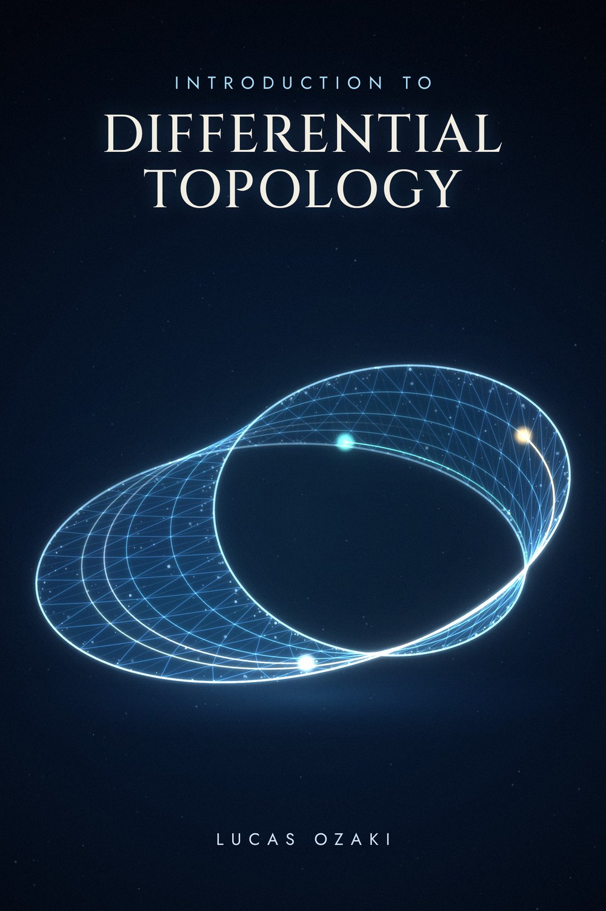

<!--
  This page only announces the book. The book itself (notes/differential-topology/) is still a draft,
  listed in .gitignore; do not link to its chapters from here until it is published.
  To use another cover, replace cover.jpg (1000 × 1500) and thumbnail.jpg (1200 × 675, used by the
  Notes listing and by link previews).
-->

:::: {.book-hero}

::: {.book-cover}
{fig-alt="Cover of Introduction to Differential Topology by Lucas Ozaki: a Möbius strip drawn as a band of blue light on a dark background."}
:::

::: {.book-about}
I am writing this book for graduate students taking a first course in differential topology, the subject that many programs call *Differentiable Manifolds* or *Smooth Manifolds*. Its goal is to help them understand the ideas behind the definitions and theorems, and to prepare them for their qualifying exams.

Its references are the classical books of the area, such as @milnor1965, @spivak1965, @hirsch1976, @guillemin2010, @lima2007 and @lee2012.

[**Status:** in preparation. The book is not available yet; it will be published on this site when it is ready.]{.book-status}
:::

::::

## How the book is organized

Each chapter has four kinds of sections.

- **Theory, with interactive figures.** In most figures you can drag the points, move the sliders and start animations, and the figures in space can be rotated.
- **Exercises** at the end of each section.
- **Extra topics**, such as the equivalence of the definitions of tangent space, Whitney's embedding theorem, the hairy ball theorem and manifolds with corners.
- **Training for the oral part of qualifying exams**, at the end of each chapter: questions of the kind asked in the oral part of a qualifying exam, to be answered out loud, without looking at the text.

## Prerequisites

Advanced calculus in $\mathbb{R}^n$ (the inverse and implicit function theorems, the local form of immersions and submersions, the rank theorem) and basic general topology (Hausdorff spaces, countable bases, compactness, connectedness and the quotient topology).

## Contents

::: {.book-contents}

### Part I · Manifolds and smooth maps

1. **Smooth manifolds**\
   [Topological manifolds, atlases and changes of coordinates, smooth structures, existence, uniqueness and classification, non-Hausdorff manifolds.]{.topics}
2. **Examples, quotient manifolds and smooth maps**\
   [Spheres and stereographic projection, products and graphs, quotient manifolds (the torus, real projective space), Lie groups and properly discontinuous actions, smooth maps and diffeomorphisms.]{.topics}
3. **Tangent spaces**\
   [Tangent vectors as classes of curves and as derivations, the differential and the chain rule, the equivalence of the definitions.]{.topics}

### Part II · Immersions, submersions and transversality

4. **Immersions, submersions and submanifolds**\
   [The inverse function theorem and the local forms, embeddings, submanifolds, the regular value theorem, Sard's theorem, immersed submanifolds and the Kronecker curve on the torus.]{.topics}
5. **Transversality**\
   [Maps transversal to a submanifold, inverse images of submanifolds, stable properties and the transversality theorem.]{.topics}

### Part III · Bundles, vector fields and orientation

6. **Vector bundles**\
   [Vector bundles and transition functions, the tangent bundle, sections and frames, subbundles.]{.topics}
7. **Vector fields**\
   [The Lie bracket, integral curves and flows, singularities, parallelizable manifolds, left-invariant fields on Lie groups.]{.topics}
8. **Orientation**\
   [Orientation of vector spaces, of manifolds and of vector bundles, normal vector fields, tubular neighborhoods.]{.topics}
9. **Partitions of unity and applications**\
   [Bump functions and partitions of unity, approximation of continuous maps, Whitney's embedding theorems, Riemannian metrics, the classification of manifolds of dimension 1.]{.topics}

### Part IV · Degree, intersection and Euler characteristic

10. **Manifolds with boundary**\
    [The tangent space at boundary points, the induced orientation on the boundary, regular values, manifolds of dimension 1 with boundary, Brouwer's fixed point theorem.]{.topics}
11. **Intersection theory and degree**\
    [Transversality and homotopies, intersection number and degree modulo 2, the Brouwer degree, the fundamental theorem of algebra, the hairy ball theorem.]{.topics}
12. **Euler characteristic and the Poincaré–Hopf theorem**\
    [The index of a singularity, triangulations and the classification of compact surfaces, the Poincaré–Hopf theorem.]{.topics}

### Part V · Differential forms and integration

13. **The cotangent bundle and 1-forms**\
    [The cotangent bundle, 1-forms and work, the pullback, line integrals, the gradient on a Riemannian manifold.]{.topics}
14. **Multilinear algebra and $k$-forms**\
    [Tensors, alternating tensors and the wedge product, tensor fields and differential $k$-forms.]{.topics}
15. **Orientation and the exterior derivative**\
    [Forms in $\mathbb{R}^2$ and $\mathbb{R}^3$, volume forms, the exterior derivative, closed and exact forms, de Rham cohomology and the Poincaré lemma.]{.topics}
16. **Integration and Stokes' theorem**\
    [Integration on manifolds, Stokes' theorem, manifolds with corners, densities.]{.topics}
17. **Lie derivative, interior product and Cartan's formula**\
    [The Lie derivative, the interior product, Cartan's magic formula, divergence and curl.]{.topics}

:::

## References

::: {#refs}
:::
