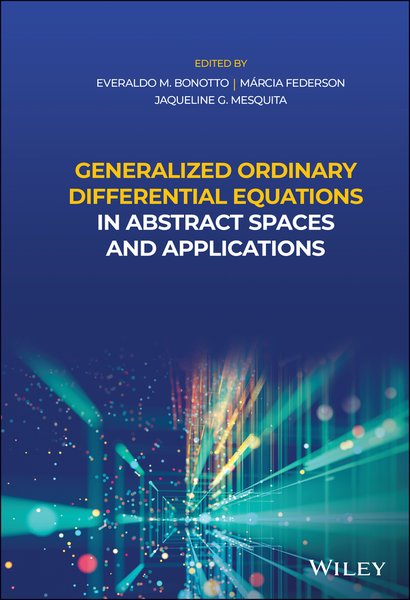

<!--
  DRAFT. The short paragraphs below are a scaffold: each one states facts that are checked
  against the cited sources, so that you can rewrite them in your own words and expand them.
  Lines starting with "TODO" are only visible here, in the source.
-->

This note tells how the theory of generalized ordinary differential equations and of non-absolute integration, born in Prague in 1957, became an active research area in Brazil, around Professor Márcia Federson, Professor Everaldo Bonotto and their collaborators and students. It ends with an interactive [family tree](#sec-family-tree) of the Brazilian group.

<!-- TODO: your own introduction (why this history matters to you, what the reader will find). -->

## Prague, 1957: an integral born from differential equations

In 1957, Jaroslav Kurzweil studied the continuous dependence of solutions of ordinary differential equations on a parameter. To describe the limits of sequences of equations $\dot x=f_k(x,t)$, he introduced *generalized ordinary differential equations*, and with them a new integral defined by Riemann-type sums with a variable mesh, which he called a generalized Perron integral and which is now called the Kurzweil integral [@kurzweil1957; @bonotto2021, Chapter 2]. Ralph Henstock introduced a similar integral independently in 1961 [@henstock1961; @bonotto2021, Foreword].

The theory was developed in Prague, around Kurzweil, by Jiří Jarník, Štefan Schwabik, Milan Tvrdý, Ivo Vrkoč, Dana Fraňková and others, and their results are described in the monographs *Generalized Ordinary Differential Equations* of Schwabik [@schwabik1992] and of Kurzweil [@bonotto2021, Foreword].

<!-- TODO: what you want to say about Kurzweil, Schwabik and the Prague school. -->

## From Prague to São Paulo

In Brazil, the theory of generalized ODEs was introduced by Štefan Schwabik during his visit to the Universidade de São Paulo, in the city of São Paulo, in 1989. It was only in 2002, however, that the theory really started to be developed in Brazil. The first Brazilian publication on the subject is the article by Márcia Federson and Plácido Táboas in the *Journal of Differential Equations* [@federson2003].

According to Jean Mawhin, a school was created at the Universidade de São Paulo, inspired by Márcia Federson's visits to Prague and by Štefan Schwabik's lectures in São Carlos, and it spread to other Brazilian institutions listed below:

  - Universidade de São Paulo, São Carlos;
  - Universidade Federal de São Carlos, São Carlos;
  - Universidade Estadual Paulista, Rio Claro;
  - Universidade Estadual de Campinas;
  - Universidade Federal de Uberlândia;
  - Universidade Federal de Juiz de Fora;
  - Universidade Federal Tecnológica do Parana.

<!--
  TODO: Federson's own path. Facts already checked: PhD at USP (1998), thesis "On the existence of
  solutions of linear integral equations with respect to gauge integrals" (in Portuguese), advisor
  Ricardo Bianconi (Mathematics Genealogy Project, id 142019); postdoc at ICMC-USP (1999–2001) and at
  the Mathematical Institute of the Academy of Sciences of the Czech Republic (2005) (her web page,
  sites.icmc.usp.br/federson).
-->

## The São Carlos school

The Brazilian research group on *Functional Differential Equations and Nonabsolute Integration* grew at the Instituto de Ciências Matemáticas e de Computação (ICMC-USP), in São Carlos. Many of its doctoral theses, listed in the [family tree](#sec-family-tree), apply generalized ODEs to functional differential equations with delays and impulses, to measure functional differential equations and dynamic equations on time scales, and to linear equations in Banach spaces.

<!--
  TODO: the main lines of research and results, the role of Everaldo Bonotto (PhD 2008, co-advised
  by Federson and by Patrick Muldowney, a student of Henstock), the cooperation with Prague
  (co-advisors Milan Tvrdý and Antonín Slavík), seminars, events...
-->

## The 2021 monograph

In 2021, members of the group published *Generalized Ordinary Differential Equations in Abstract Spaces and Applications*, edited by Everaldo M. Bonotto, Márcia Federson and Jaqueline G. Mesquita, with fourteen contributors and a foreword by Jean Mawhin [@bonotto2021]. The book is dedicated to the memory of Luciene P. Gimenes Arantes and Štefan Schwabik.

::::: {.book-grid}

:::: {.book-chapters}
**Contents**

1. **Preliminaries.** Regulated functions, functions of bounded $B$-variation, and the Kurzweil and Henstock integrals of Banach-space-valued functions.
2. **The Kurzweil integral.** Definition and basic properties: Saks–Henstock lemma, Hake-type theorem, change of variables; the Kapitza pendulum.
3. **Measure functional differential equations.** Impulsive equations, dynamic equations on time scales, averaging methods.
4. **Generalized ODEs.** Fundamental properties; relations with measure differential and measure functional differential equations.
5. **Basic properties of solutions.** Local existence and uniqueness, prolongation and maximal solutions.
6. **Linear generalized ODEs.** The fundamental operator and variation-of-constants formulas.
7. **Continuous dependence on parameters.**
8. **Stability theory.** Variational, Lyapunov and regular stability; direct and converse Lyapunov theorems.
9. **Periodicity.** Floquet's theorem and $(\theta,T)$-periodic solutions.
10. **Averaging principles.** Periodic and nonperiodic averaging.
11. **Boundedness of solutions.** Lyapunov functionals, with an application to measure differential equations.
12. **Control theory.** Controllability and observability.
13. **Dichotomies.** Boundedness and dichotomies, with applications to measure and impulsive equations.
14. **Topological dynamics.** Semidynamical systems, LaSalle's invariance principle, recursive properties.
15. **Functional differential equations of neutral type.**
::::

:::: {.book-cover}
{fig-alt="Cover of Generalized Ordinary Differential Equations in Abstract Spaces and Applications, edited by Bonotto, Federson and Mesquita (Wiley, 2021)."}
::::

:::::

<!-- TODO: why the book matters. -->

<!-- TODO: a section "The group today": where the group is now (institutions, new generations,
     international collaborations). -->

## Family tree {#sec-family-tree}

The tree shows the people who studied generalized ODEs or non-absolute integration in the Brazilian group, together with the Prague mathematicians connected to it. A line goes from each advisor to each of their doctoral students, co-advisors included; advisors who worked in other areas are not drawn, and their names appear in the details of their students. Hover over a name (or tap it, on a phone) to see the fields the person works on, and click it to open the person's Lattes CV or web page. The data come from the [Mathematics Genealogy Project](https://mathgenealogy.org), from the Lattes CVs and from personal pages.

::: {.column-page}
```{=html}
<div id="family-tree" class="family-tree">
  <noscript>The interactive family tree needs JavaScript.</noscript>
</div>
<script src="genealogy.js"></script>
<script src="family-tree.js"></script>
```
:::

## Further material

- Márcia Federson, *Universidade de São Paulo*, talk at IMSA ([YouTube](https://www.youtube.com/watch?v=igS95ORzfFA&t=989s)).
- Fernanda Andrade da Silva, *Webinar de jovens pesquisadores em EDP e matemática aplicada* ([YouTube](https://www.youtube.com/watch?v=YzfmaX937gU&t=1629s)).
