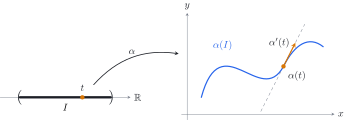

\newcommand{\R}{\mathbb{R}}

<!--
  DRAFT. Sections 1–3 are written out (definitions, the examples of the Manim animation, and the
  first results); "What comes next" lists the topics still to be written. Rewrite freely.
-->

These notes cover the first topics of a course in differential geometry: the local theory of plane curves. We follow do Carmo [@docarmo2014; @docarmo2016, Chapter 1], Tenenblat [@tenenblat2008] and the course notes of Delgado and Frensel [@delgadofrensel, Chapter 1]. The first examples are the curves of the animation [Plane curves in Differential Geometry](../../manim/plane-curves/index.qmd), in which each parametrization is read off the motion of a rolling circle.

I am especially grateful to the professors who taught me differential geometry at different stages of my undergraduate studies: Prof. João Paulo Cerri, who first introduced me to its basic concepts in my first year, back in 2018, and Profa. Eliris Cristina Rizziolli, who taught me the Differential Geometry course in my third year.

## Parametrized differentiable curves {#sec-curves}

::: {#def-curve}
## Parametrized differentiable curve
A *parametrized differentiable curve* in the plane is a map $\alpha\colon I\to\R^2$, $\alpha(t)=(x(t),y(t))$, of class $C^\infty$ on an open interval $I\subset\R$. The variable $t$ is the *parameter*, the set $\alpha(I)\subset\R^2$ is the *trace* of $\alpha$, and the vector $\alpha'(t)=(x'(t),y'(t))$ is the *tangent vector*, or velocity vector, of $\alpha$ at $t$.
:::

{#fig-curve width="85%" fig-alt="An open interval I on the real line with a point t, an arrow alpha to a curve in the xy-plane, the point alpha(t) on the curve and the tangent vector alpha'(t) along the dashed tangent line."}

::: {#rem-curves-rn}
## Curves in $\R^n$
@def-curve makes sense word for word for a map $\alpha=(x_1,\dots,x_n)\colon I\to\R^n$ of class $C^\infty$, whose tangent vector is $\alpha'(t)=(x_1'(t),\dots,x_n'(t))$. For $n=3$ these are the curves in space [@delgadofrensel, Chapter 2].
:::

A curve is the map, not its trace. The maps $\alpha(t)=(\cos t,\sin t)$ and $\beta(t)=(\cos 2t,\sin 2t)$, $t\in\R$, are different curves with the same trace, the unit circle: $\beta$ runs around it twice as fast. It helps to think of $t$ as time and of $\alpha(t)$ as the position of a moving point. The trace records where the point has been; the parametrization also records when, and how fast.

### Curves traced by rolling circles {#sec-rolling}

The key observation is that rolling without slipping turns arc length into distance. When a circle of radius $r$ has turned through an angle $t$, its point of contact has moved a distance $rt$ along the line or the circle on which it rolls. In each example below, this observation gives the parametrization; the link after each example opens the part of the animation [Plane curves in Differential Geometry](../../manim/plane-curves/index.qmd) that shows it step by step.

::: {#exm-cycloid}
## The cycloid
A circle of radius $r>0$ rolls without slipping along the $x$-axis, and $P$ is the point of the circle that starts at the origin. When the circle has turned through the angle $t$, its center is at $(rt,r)$ and
$$
\alpha(t)=(rt-r\sin t,\ r-r\cos t),\qquad t\in\R .
$$
The trace of $\alpha$ is the *cycloid*.
:::

::: {.anim-ref}
▶ See it in the animation: [I. The cycloid, from 0:10](../../manim/plane-curves/index.html?t=10).
:::

::: {#exm-trochoid}
## Trochoids
Let $P$ be a point rigidly attached to the rolling circle of @exm-cycloid, at distance $R>0$ from its center. Then
$$
\alpha(t)=(rt-R\sin t,\ r-R\cos t),\qquad t\in\R .
$$
For $R>r$ the trace is a *prolate cycloid*, which has loops; for $R=r$ it is the cycloid; for $R<r$ it is a *curtate cycloid*.
:::

::: {.anim-ref}
▶ See it in the animation: [II. Trochoids, from 1:10](../../manim/plane-curves/index.html?t=70).
:::

::: {#exm-epicycloid}
## Epicycloids
A circle of radius $r$ rolls without slipping on the outside of a fixed circle $\Gamma$ of radius $R$ centered at the origin, and $P$ is the point of the rolling circle that starts at $(R,0)$. If $\theta$ is the angle of the center of the rolling circle, the arcs rolled on both circles have the same length, $R\theta=rt$, and
$$
\alpha(\theta)=\Bigl((R+r)\cos\theta-r\cos\bigl(\tfrac{R+r}{r}\theta\bigr),\ (R+r)\sin\theta-r\sin\bigl(\tfrac{R+r}{r}\theta\bigr)\Bigr),\qquad \theta\in\R .
$$
For $r=R$ the trace is the *cardioid*. When $R/r=n$ is an integer, the curve closes after one turn of the center, and $P$ touches $\Gamma$ exactly $n$ times.
:::

::: {.anim-ref}
▶ See it in the animation: [III. The epicycloid, from 2:00](../../manim/plane-curves/index.html?t=120) (gallery of epicycloids from 2:55).
:::

::: {#exm-hypocycloid}
## Hypocycloids
If the circle of radius $r<R$ rolls on the inside of $\Gamma$, the same reasoning gives
$$
\alpha(\theta)=\Bigl((R-r)\cos\theta+r\cos\bigl(\tfrac{R-r}{r}\theta\bigr),\ (R-r)\sin\theta-r\sin\bigl(\tfrac{R-r}{r}\theta\bigr)\Bigr),\qquad \theta\in\R .
$$
For $R=2r$ the point $P$ only moves along a diameter of $\Gamma$, since $\alpha(\theta)=(R\cos\theta,0)$. For $R=3r$ the trace is the *deltoid*, and for $R=4r$ it is the *astroid*, $\alpha(\theta)=(R\cos^3\theta,\ R\sin^3\theta)$.
:::

::: {.anim-ref}
▶ See it in the animation: [IV. The hypocycloid, from 3:25](../../manim/plane-curves/index.html?t=205) (galleries from 4:10).
:::

::: {#exm-lemniscate}
## Bernoulli's lemniscate
Let
$$
\alpha(t)=\Bigl(\frac{t}{1+t^4},\ \frac{t^3}{1+t^4}\Bigr),\qquad t\in\R .
$$
Since $x^2+y^2=\dfrac{t^2}{1+t^4}$ and $xy=\dfrac{t^4}{(1+t^4)^2}$, the trace lies on the curve $(x^2+y^2)^2=xy$, which in polar coordinates reads $\rho^2=\frac12\sin 2\theta$: a Bernoulli lemniscate. The map $\alpha$ is injective and passes through the origin only at $t=0$, but $\alpha(t)\to(0,0)$ as $t\to\pm\infty$: the curve comes back as close as we like to one of its points without passing through it again.
:::

::: {.anim-ref}
▶ See it in the animation: [V. Bernoulli's lemniscate, from 4:55](../../manim/plane-curves/index.html?t=295).
:::

## Regular curves {#sec-regular}

::: {#def-regular}
## Regular curve
A parametrized differentiable curve $\alpha\colon I\to\R^2$ is *regular at* $t_0\in I$ if $\alpha'(t_0)\neq0$, or equivalently, if $\|\alpha'(t_0)\|\neq0$. We say that $\alpha$ is *regular* if it is regular at every $t\in I$. A parameter $t$ with $\alpha'(t)=0$ is a *singular point* (or singularity) of $\alpha$.
:::

::: {#rem-regular-rn}
## Regular curves in $\R^n$
@def-regular, and the tangent line below, are the same for curves $\alpha\colon I\to\R^n$, with $\|\cdot\|$ the Euclidean norm of $\R^n$.
:::

At a regular point, $\alpha$ has a tangent line: the line through $\alpha(t)$ in the direction of $\alpha'(t)$ given by
$$
r_{t}(u) = \alpha(t) + u \alpha'(t),\quad u\in\R,
$$
and it is known that $r_{t}(u)$ is the best linear approximation of $\alpha$ at $t$.

The examples above show what can happen at singular points.

- **Cycloid.** $\alpha'(t)=r(1-\cos t,\ \sin t)$ and $|\alpha'(t)|=r\sqrt{2-2\cos t}=2r\,\bigl|\sin\tfrac t2\bigr|$. So $\alpha'(t)=0$ exactly when $t\in2\pi\mathbb Z$, the instants when $P$ touches the axis. These are the cusps of the cycloid, and the cycloid is not regular.
- **Trochoids.** $\alpha'(t)=(r-R\cos t,\ R\sin t)$. If $\alpha'(t)=0$, then $\sin t=0$, so $\cos t=\pm1$ and $r=\pm R$; since $r,R>0$, this forces $R=r$. Hence prolate and curtate cycloids are regular, and among the trochoids only the cycloid has singular points.
- **Epicycloids and hypocycloids.** With $k=\frac{R\pm r}{r}$,
  $$
  \alpha'(\theta)=(R\pm r)\bigl(-\sin\theta\pm\sin k\theta,\ \cos\theta-\cos k\theta\bigr),
  $$
  with the upper signs for the epicycloid and the lower signs for the hypocycloid. In both cases $\alpha'(\theta)=0$ if and only if $\frac Rr\theta\in2\pi\mathbb Z$, that is, exactly when $P$ touches $\Gamma$. These are the cusps.
- **Lemniscate.** $\alpha'(t)=\dfrac{\bigl(1-3t^4,\ t^2(3-t^4)\bigr)}{(1+t^4)^2}$. The first coordinate vanishes only if $t^4=\frac13$, and then the second one does not. So the lemniscate of @exm-lemniscate is regular, although near the origin its trace looks like two branches crossing: one is run through at $t=0$ with tangent vector $(1,0)$, the other is only approached as $t\to\pm\infty$.

A singular point does not always show in the trace. The curve $\alpha(t)=(t^3,t^3)$ is not regular at $t=0$, although its trace is a straight line. The curve $\alpha(t)=(t^3,t^2)$ is not regular at $t=0$ either, and its trace has a cusp at the origin (@fig-singular).

```{python}
#| label: fig-singular
#| fig-cap: "Left: at a regular point $\\alpha(t)$ the tangent line $r_t$ is defined. Middle and right: the curves $(t^3,t^2)$ and $(t^3,t^3)$, with dots at $t=-1,-0.9,\\dots,1$. Near $t=0$ the dots crowd together, because the speed $|\\alpha'(t)|$ tends to $0$; the first trace has a cusp at the origin, the second is a straight line."
#| code-fold: true
#| code-summary: "Show the Python code"
import matplotlib.pyplot as plt
import numpy as np

BLUE, ORANGE, GREY = "#2563eb", "#d97706", "#6b7280"
fig, axes = plt.subplots(1, 3, figsize=(9.6, 3.3))

# (a) a regular curve, alpha(t) = (t, t^3/2 - t/2), and its tangent line at t0 = 0.9
ax = axes[0]
t = np.linspace(-1.25, 1.35, 300)
ax.plot(t, t**3 / 2 - t / 2, color=BLUE, lw=2)
t0 = 0.9
p = np.array([t0, t0**3 / 2 - t0 / 2])
v = np.array([1.0, 1.5 * t0**2 - 0.5])                  # alpha'(t0)
u = np.linspace(-0.9, 0.75, 2)
ax.plot(p[0] + u * v[0], p[1] + u * v[1], "--", color=GREY, lw=1.2)
ax.annotate("", p + 0.55 * v, p, arrowprops=dict(arrowstyle="-|>", color=ORANGE, lw=2))
ax.plot(*p, "o", color=ORANGE, ms=6, zorder=3)
ax.text(p[0] + 0.05, p[1] - 0.22, r"$\alpha(t)$", fontsize=11)
ax.text(p[0] + 0.62, p[1] + 0.12, r"$\alpha'(t)$", fontsize=11, color=ORANGE)
ax.text(-0.55, -0.85, r"$r_t$", fontsize=11, color=GREY)
ax.set_title("regular point", fontsize=11)

# (b), (c) singular at t = 0: dots at equally spaced parameters
tk = np.linspace(-1, 1, 21)
for ax, (fx, fy, title) in zip(axes[1:], [(lambda t: t**3, lambda t: t**2, r"$(t^3,\,t^2)$: a cusp"),
                                         (lambda t: t**3, lambda t: t**3, r"$(t^3,\,t^3)$: a line")]):
    t = np.linspace(-1.1, 1.1, 400)
    ax.plot(fx(t), fy(t), color=BLUE, lw=2)
    ax.plot(fx(tk), fy(tk), "o", color=ORANGE, ms=4, zorder=3)
    ax.annotate(r"$\alpha'(0)=0$", (0, 0), xytext=(0.3, -0.8), fontsize=10,
                arrowprops=dict(arrowstyle="-", color=GREY, lw=0.8))
    ax.set_title(title, fontsize=11)

for ax in axes:
    ax.set_aspect("equal")
    ax.axhline(0, color="black", lw=0.6)
    ax.axvline(0, color="black", lw=0.6)
    ax.set_xticks([])
    ax.set_yticks([])
    for side in ["left", "right", "top", "bottom"]:
        ax.spines[side].set_visible(False)
axes[0].set_xlim(-1.4, 1.6)
axes[0].set_ylim(-1.1, 1.2)
for ax in axes[1:]:
    ax.set_xlim(-1.4, 1.4)
    ax.set_ylim(-1.3, 1.3)
fig.tight_layout()
plt.show()
```

Regularity rules out cusps and corners at a point that the curve passes through once: near such a point, the trace of a regular curve is the graph of a smooth function.

::: {#prp-local-graph}
## A regular curve is locally a graph
Let $\alpha=(x,y)\colon I\to\R^2$ be regular at $t_0$. Then there is an open interval $I_0\ni t_0$ such that $\alpha$ is injective on $I_0$ and $\alpha(I_0)$ is the graph of a $C^\infty$ function: of the form $y=g(x)$ if $x'(t_0)\neq0$, and of the form $x=g(y)$ if $y'(t_0)\neq0$.
:::

::: {#rem-local-graph-rn}
## In $\R^n$
If $\alpha=(x_1,\dots,x_n)\colon I\to\R^n$ is regular at $t_0$, then $x_j'(t_0)\neq0$ for some $j$, and the same proof shows that near $\alpha(t_0)$ the trace is the graph of a $C^\infty$ map from an interval of the $x_j$-axis to the other $n-1$ coordinates.
:::

## Arc length and reparametrization {#sec-arclength}

::: {#def-arclength}
## Arc length
Let $\alpha\colon I\to\R^2$ be a parametrized differentiable curve. The *length* of $\alpha$ on $[a,b]\subset I$ is
$$
\ell(\alpha;a,b)=\int_a^b|\alpha'(t)|\,dt .
$$
If $\alpha$ is regular and $t_0\in I$, the function $s(t)=\int_{t_0}^{t}|\alpha'(\xi)|\,d\xi$, $t\in I$, is the *arc length* of $\alpha$ from $t_0$.
:::

::: {#rem-arclength-rn}
## Arc length in $\R^n$
The same formulas define the length and the arc length of a curve $\alpha\colon I\to\R^n$ with $|\alpha'(t)|$ the Euclidean norm $\bigl(x_1'(t)^2+\cdots+x_n'(t)^2\bigr)^{1/2}$.
:::

The definition agrees with intuition: for a curve of class $C^1$, $\ell(\alpha;a,b)$ is the limit of the lengths of the polygons inscribed in $\alpha|_{[a,b]}$, as the mesh of the partition tends to $0$ [@delgadofrensel, Chapter 1, Theorem 2.1]. The same holds in $\R^n$ (@fig-polygon).

```{python}
#| label: fig-polygon
#| fig-cap: "Polygons inscribed in the curve $\\alpha(t)=(t,\\,0.6\\sin 1.8t)$, $0\\le t\\le 3.2$, for partitions of $[0,\\,3.2]$ into equal subintervals. As the mesh tends to $0$, their lengths increase to $\\ell(\\alpha;0,3.2)=\\int_0^{3.2}|\\alpha'(t)|\\,dt$."
#| code-fold: true
#| code-summary: "Show the Python code"
import matplotlib.pyplot as plt
import numpy as np

BLUE, ORANGE = "#2563eb", "#d97706"
x = lambda t: t
y = lambda t: 0.6 * np.sin(1.8 * t)
a, b = 0.0, 3.2

tt = np.linspace(a, b, 4001)
speed = np.sqrt(1 + (1.08 * np.cos(1.8 * tt)) ** 2)       # |alpha'(t)|
length = np.sum((speed[1:] + speed[:-1]) / 2 * np.diff(tt))  # trapezoidal rule

fig, axes = plt.subplots(1, 3, figsize=(10, 2.8))
for ax, n in zip(axes, [3, 6, 12]):
    tk = np.linspace(a, b, n + 1)
    poly = np.sum(np.hypot(np.diff(x(tk)), np.diff(y(tk))))
    ax.plot(x(tt), y(tt), color=BLUE, lw=2)
    ax.plot(x(tk), y(tk), "-o", color=ORANGE, lw=1.4, ms=4)
    ax.set_title(f"{n} segments: length {poly:.3f}", fontsize=10.5)
    ax.set_aspect("equal")
    ax.axis("off")
fig.suptitle(f"length of the curve: {length:.3f}", fontsize=11)
fig.tight_layout()
plt.show()
```

::: {#exm-cycloid-length}
## One arch of the cycloid
By the computation of $|\alpha'|$ in [the section on regular curves](#sec-regular), one arch of the cycloid, between two consecutive cusps, has length
$$
\int_0^{2\pi}2r\sin\tfrac t2\,dt=\Bigl[-4r\cos\tfrac t2\Bigr]_0^{2\pi}=8r ,
$$
four times the diameter of the rolling circle.
:::

Two differentiable curves can have the same trace even if their expressions are different. In fact, a parametized differentiable curve 

::: {#def-reparametrization}
## Reparametrization
Let $\alpha\colon I\to\R^2$ be a regular curve, $J$ an open interval and $h\colon J\to I$ a $C^\infty$ function with $h(J)=I$ and $h'(\tau)\neq0$ for every $\tau\in J$. The curve $\beta=\alpha\circ h\colon J\to\R^2$ is a *reparametrization* of $\alpha$. It preserves the orientation if $h'>0$ and reverses it if $h'<0$.
:::

![A reparametrization $\beta=\alpha\circ h$ of $\alpha$: the parameter $\tau\in J$ is first sent by $h$ to $t=h(\tau)\in I$, and then by $\alpha$ to the point $\alpha(t)=\beta(\tau)$. Both curves have the same trace (compare [@delgadofrensel, Chapter 1, Fig. 10]).](figures/reparametrization.svg){#fig-reparametrization width="85%" fig-alt="Two open intervals, J below and I above, with a point tau in J sent by h to t = h(tau) in I; an arrow alpha from I and an arrow beta = alpha composed with h from J both reach the same point alpha(t) = beta(tau) on a curve in the plane."}

::: {#rem-reparametrization-rn}
## In $\R^n$
@def-reparametrization, and everything that follows in this section, is the same for regular curves $\alpha\colon I\to\R^n$.
:::

A reparametrization has the same trace as $\alpha$, and it is regular, because $\beta'(\tau)=h'(\tau)\,\alpha'(h(\tau))\neq0$. A regular curve is *parametrized by arc length* if $|\alpha'(t)|=1$ for every $t\in I$; then its length on $[a,b]$ is $b-a$. Length is a property of the trace and not of the parametrization:

::: {#prp-length-invariant}
## Length does not depend on the parametrization
Let $\beta=\alpha\circ h\colon J\to\R^2$ be a reparametrization of $\alpha\colon I\to\R^2$ and let $[c,d]\subset J$. Then $\ell(\beta;c,d)=\ell\bigl(\alpha;h(c),h(d)\bigr)$ if $h'>0$, and $\ell(\beta;c,d)=\ell\bigl(\alpha;h(d),h(c)\bigr)$ if $h'<0$.
:::

::: {.proof}
By the chain rule, $|\beta'(\tau)|=|h'(\tau)|\,|\alpha'(h(\tau))|$. If $h'>0$, the substitution $t=h(\tau)$ gives
$$
\ell(\beta;c,d)=\int_c^d|\alpha'(h(\tau))|\,h'(\tau)\,d\tau=\int_{h(c)}^{h(d)}|\alpha'(t)|\,dt=\ell\bigl(\alpha;h(c),h(d)\bigr).
$$
If $h'<0$, then $|h'|=-h'$, and the same substitution gives $\ell(\beta;c,d)=\int_{h(d)}^{h(c)}|\alpha'(t)|\,dt$.
:::

::: {#prp-arclength}
## Parametrization by arc length
Every regular curve has an orientation-preserving reparametrization by arc length.
:::

::: {.proof}
Let $\alpha\colon I\to\R^2$ be regular, fix $t_0\in I$ and let $s(t)=\int_{t_0}^{t}|\alpha'(\xi)|\,d\xi$. Since $\alpha'$ never vanishes, $|\alpha'|$ is of class $C^\infty$, so $s$ is $C^\infty$ with $s'(t)=|\alpha'(t)|>0$ by the Fundamental Theorem of Calculus. Hence $s$ is a strictly increasing $C^\infty$ function from $I$ onto the open interval $J=s(I)$, and by the inverse function theorem its inverse $h=s^{-1}\colon J\to I$ is $C^\infty$, with $h'(\sigma)=1/|\alpha'(h(\sigma))|>0$. The curve $\beta=\alpha\circ h$ satisfies
$$
|\beta'(\sigma)|=h'(\sigma)\,|\alpha'(h(\sigma))|=1\qquad\text{for every }\sigma\in J .
$$
:::

::: {#rem-helix}
## Arc length in $\R^n$: the helix
@prp-length-invariant and @prp-arclength hold, with the same proofs, for regular curves in $\R^n$. For example, the circular helix $\alpha(t)=(a\cos t,\ a\sin t,\ bt)$ in $\R^3$, with $a>0$ and $b\neq0$, has constant speed $|\alpha'(t)|=\sqrt{a^2+b^2}=:c$. So $s(t)=ct$, and $\beta(s)=\bigl(a\cos\frac sc,\ a\sin\frac sc,\ \frac{bs}{c}\bigr)$ is its reparametrization by arc length.
:::

For the circle $\alpha(t)=(r\cos t,r\sin t)$ we have $|\alpha'|=r$ and $s(t)=rt$, so $\beta(\sigma)=\bigl(r\cos\frac{\sigma}{r},\,r\sin\frac{\sigma}{r}\bigr)$. In general $s^{-1}$ has no closed form; for an ellipse, for instance, $s$ is an elliptic integral. Arc length is nevertheless the natural parameter for the theory, because it does not change under reparametrization: if $\beta=\alpha\circ h$ with $h'>0$, the arc lengths of $\alpha$ and $\beta$ differ only by a constant.

::: {#exm-log-spiral}
## The logarithmic spiral
Let $\alpha(t)=(e^t\cos t,\ e^t\sin t)$, $t\in\R$. Then $\alpha'(t)=e^t(\cos t-\sin t,\ \sin t+\cos t)$ and $|\alpha'(t)|=\sqrt2\,e^t$, so the arc length from $t_0=0$ is
$$
s(t)=\int_0^t\sqrt2\,e^\xi\,d\xi=\sqrt2\,(e^t-1),
$$
a bijection from $\R$ onto $(-\sqrt2,\infty)$ with inverse $t=\ln\bigl(1+\frac{s}{\sqrt2}\bigr)$. Hence
$$
\beta(s)=\Bigl(1+\frac{s}{\sqrt2}\Bigr)\Bigl(\cos\ln\bigl(1+\tfrac{s}{\sqrt2}\bigr),\ \sin\ln\bigl(1+\tfrac{s}{\sqrt2}\bigr)\Bigr),\qquad -\sqrt2<s<\infty,
$$
is the reparametrization of $\alpha$ by arc length [@delgadofrensel, Chapter 1, Example 2.5]. As $t\to-\infty$ the spiral turns infinitely many times around the origin, yet $s(t)\to-\sqrt2$: the part of the spiral inside the unit circle has finite length $\sqrt2$.
:::

```{python}
#| label: fig-spiral
#| fig-cap: "The logarithmic spiral of @exm-log-spiral. Left: the points $\\alpha(t)$ for equally spaced $t$ get farther apart as the speed $\\sqrt2\\,e^t$ grows. Right: the points $\\beta(s)$ for equally spaced $s$ are equally far apart along the curve."
#| code-fold: true
#| code-summary: "Show the Python code"
import matplotlib.pyplot as plt
import numpy as np

BLUE, ORANGE = "#2563eb", "#d97706"
alpha = lambda t: (np.exp(t) * np.cos(t), np.exp(t) * np.sin(t))
beta = lambda s: alpha(np.log(1 + s / np.sqrt(2)))          # arc-length parametrization
s_of = lambda t: np.sqrt(2) * (np.exp(t) - 1)

fig, axes = plt.subplots(1, 2, figsize=(8, 3.9))
t = np.linspace(-6, 1, 1500)
for ax in axes:
    ax.plot(*alpha(t), color=BLUE, lw=1.8)
    ax.plot(0, 0, "+", color="black", ms=8)
    ax.set_aspect("equal")
    ax.axis("off")

tk = np.arange(-2.0, 1.0001, 0.25)                           # equally spaced t
axes[0].plot(*alpha(tk), "o", color=ORANGE, ms=5)
axes[0].set_title(r"$\alpha(t)$, $t=-2,-1.75,\dots,1$", fontsize=11)

sk = np.arange(s_of(-2.0), s_of(1.0) + 1e-9, 0.25)             # equally spaced s
axes[1].plot(*beta(sk), "o", color=ORANGE, ms=5)
axes[1].set_title(r"$\beta(s)$, $s$ in steps of $0.25$", fontsize=11)
fig.tight_layout()
plt.show()
```

## What comes next

<!-- TODO: write these sections. The numbers refer to Chapter 1 of Delgado and Frensel. -->

The next sections follow @delgadofrensel [Chapter 1, Sections 3–6] and @docarmo2016 [Chapter 1]:

1. orientation of the plane and the Frenet frame $\{\mathbf t,\mathbf n\}$ of a curve parametrized by arc length;
2. signed curvature and the Frenet formulas $\mathbf t'=\kappa\,\mathbf n$, $\mathbf n'=-\kappa\,\mathbf t$, and the curvature for an arbitrary parameter, $\kappa=\dfrac{x'y''-x''y'}{(x'^2+y'^2)^{3/2}}$;
3. the fundamental theorem of plane curves: the curvature determines the curve up to a rigid motion;
4. the local canonical form of a plane curve.

## Further material

- Lucas Ambrozio, *Geometria Diferencial de Curvas e Superfícies*, Aula 01, Programa de Mestrado, IMPA, 2023 ([video](https://www.youtube.com/watch?v=B3sfDFpiGU8&list=PLo4jXE-LdDTQb-cZsotkWZZldHXpCajl0)).
